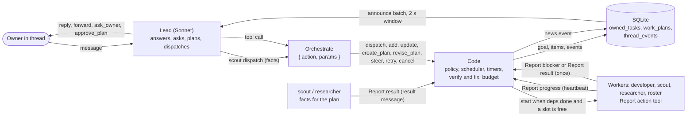
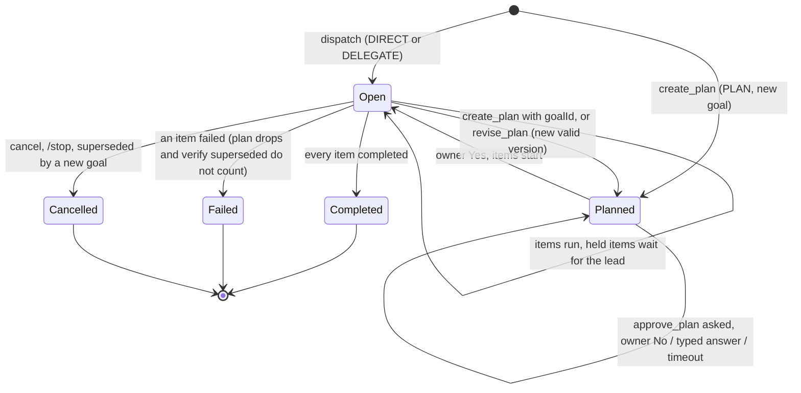
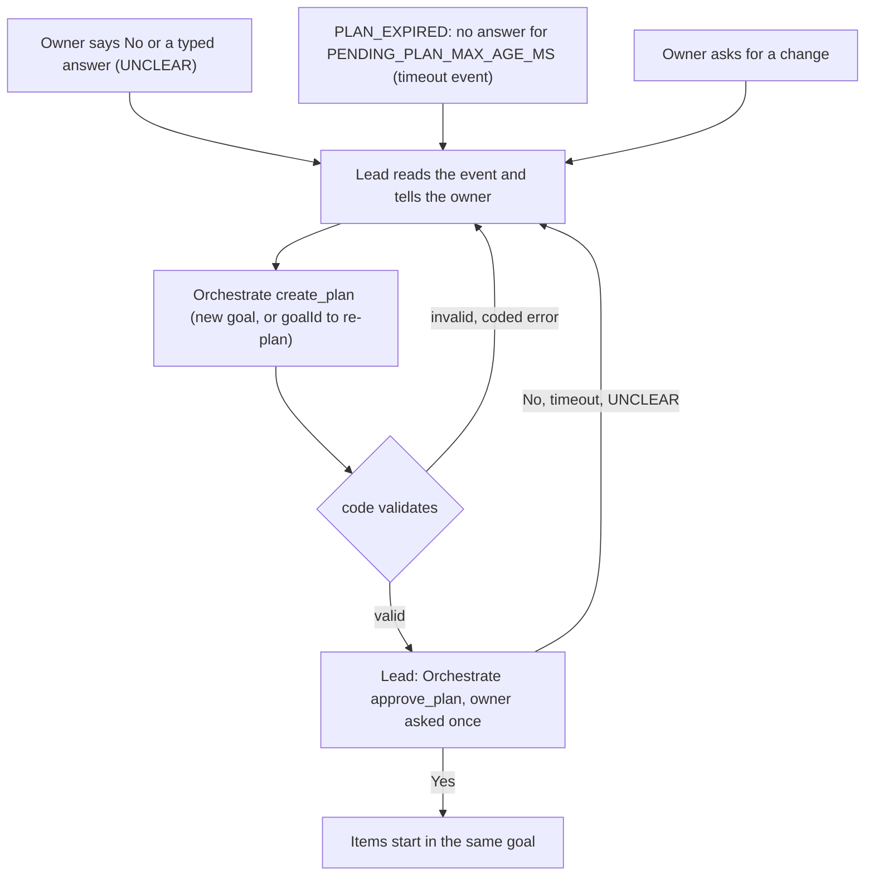
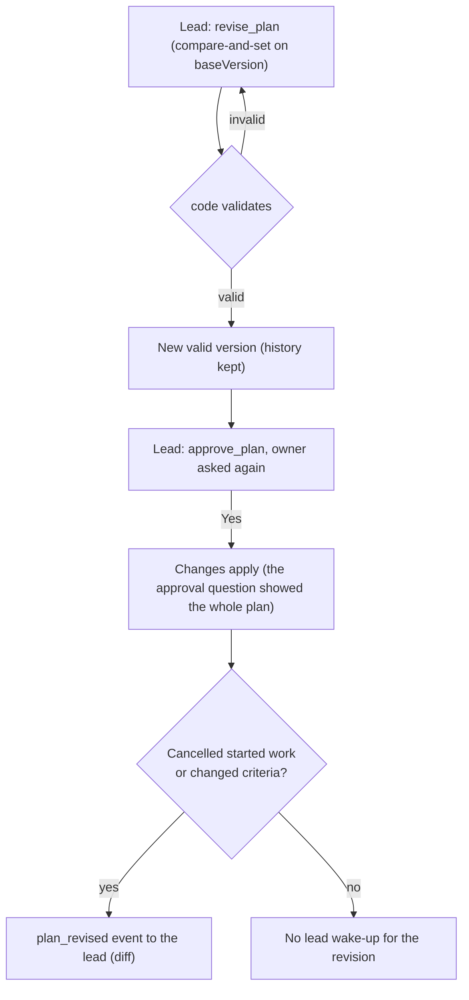
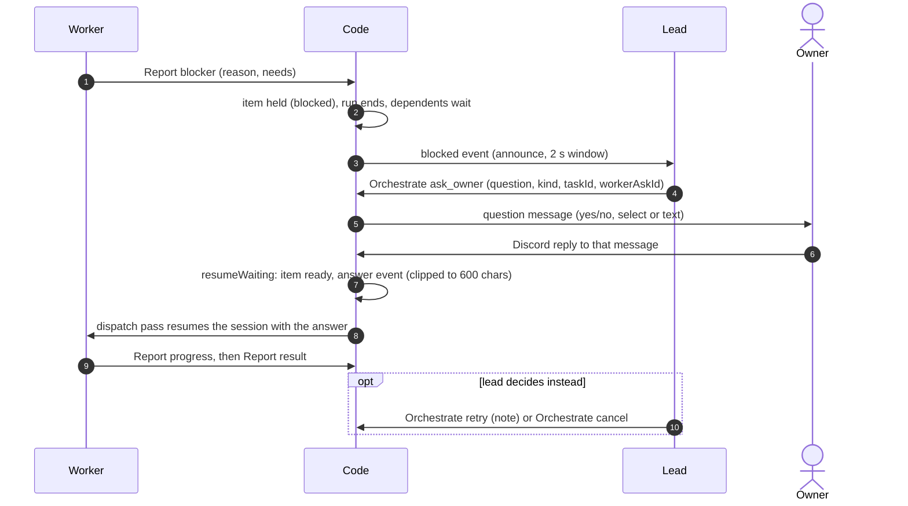

# Lead Team Flow (diagrams)

Current code after the planner removal (2026-10-22). The lead writes the plan itself; no planner role, no rolling waves. Source of truth: the code; prose in [system-architecture.md](system-architecture.md#lead-orchestration). Plan: `plans/261022-1748-remove-planner-lead-plans/`.

## Contents
- [1. Message flow](#1-message-flow-lead--orchestrate--workers--report--thread_events--lead) · [2. Goal lifecycle](#2-goal-lifecycle)
- [3. Plan, revision and re-plan](#3-plan-revision-and-re-plan-same-goal) · [4. Plan artifact and /plan](#4-plan-artifact-and-plan-beside-the-revision-line)
- [5. Blocker path](#5-blocker-path-report-blocker--ask_owner--reply--auto-resume)

## 1. Message flow: lead → Orchestrate → workers → Report → thread_events → lead

Code decides and writes state; the lead and the roles decide the work. The lead is the only owner-facing voice and the only writer of plans.

## 2. Goal lifecycle

A goal is one root row. Its items are its children. A held item keeps the goal open until the lead decides.

- Item states (`pending`, `ready`, `running`, `waiting_user`, `blocked` = held, `completed`, `failed`, `cancelled`): [system-architecture.md, Goal and item model](system-architecture.md#goal-and-item-model).
- Structure owner: `lead` for DIRECT / DELEGATE, `plan` for PLAN (set at `create_plan`). Code refuses the other path's writes.
- An empty PLAN goal (no items, no valid or approved version) is cancelled by the plan-expiry sweep after `2 x PENDING_PLAN_MAX_AGE_MS`.

## 3. Plan, revision and re-plan (same goal)

The lead brainstorms with the owner, gets code facts from a scout, writes the spec and plan as the `spec` and `plan` fields of `create_plan` (stored on the version; no artifact). Every stored version waits for the owner's answer to `approve_plan`.

Revision of a stored plan (`Orchestrate revise_plan`, lead):

- A goal that still has work, or has no items after a reject or expiry, keeps its id: `create_plan` with the goal id stores the next version.
- Every revision asks the owner again; there is no auto-applied revision and no rolling waves.
- Limits (`PENDING_PLAN_MAX_AGE_MS`, `PLAN_MAX_REVISIONS`): [limits](limits-and-stop-conditions.md).

## 4. Plan artifact and /plan beside the revision line

Each plan version is a channel artifact (`Plan <goal8> v<N>`), synced on every reader. The owner sees it through the revision line button, `/plan`, or the digest. The lead never sends a link.

- The owner line `Plan vN → vN+1` is posted by code only for a re-plan after a reject (`create_plan` with the goal id); `revise_plan` posts none, the approval question carries the whole plan. The lead still gets `plan_revised` when an approved revision cancelled work or changed criteria.
- Viewer off (`VIEWER_SECRET` / `VIEWER_BASE_URL` unset): no link anywhere; `/plan` still lists the items.
- Commands and copy: [system-architecture.md, Plan view](system-architecture.md#plan-view-plan-revision-line-plan-artifact).

## 5. Blocker path: Report blocker → ask_owner → reply → auto resume

A worker that cannot go on holds its own item. The owner's reply to the lead's question resumes it. The lead may instead retry or cancel.

- Needs values: `answer`, `access`, `decision`, `other`.
- A plain thread message (not a reply to the question) goes to the lead, not to the worker.
