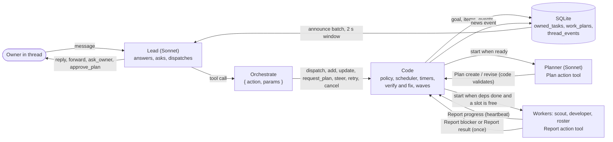
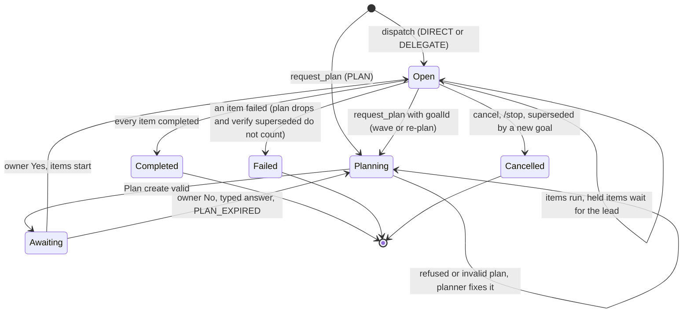
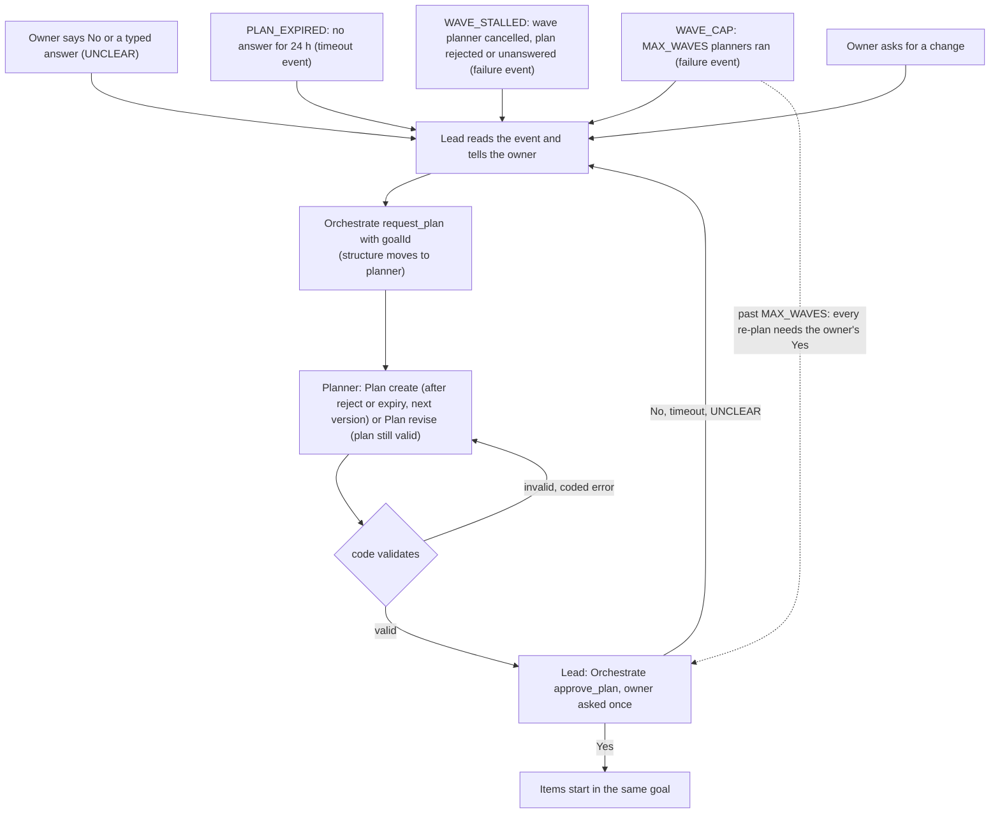
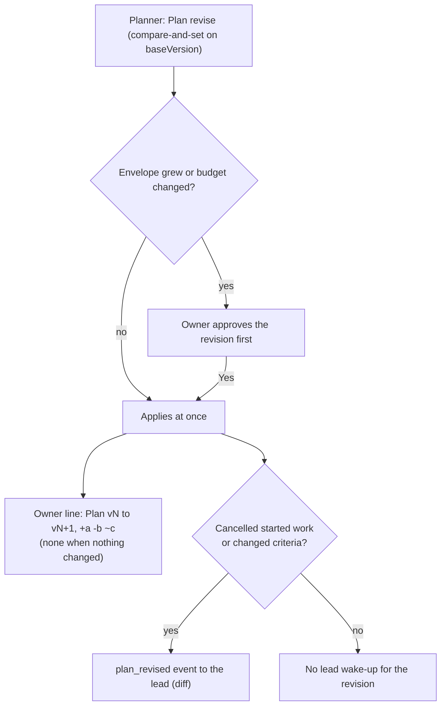
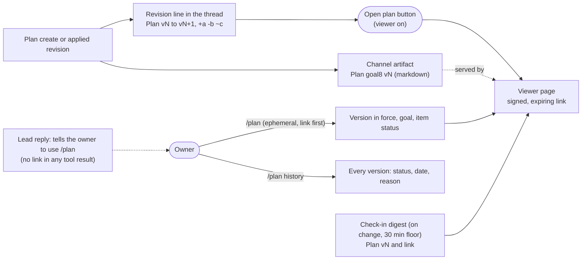
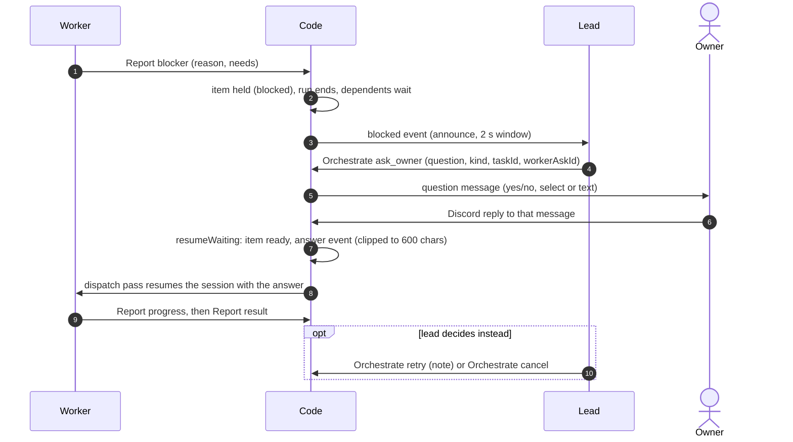

# Lead Team Flow (diagrams)

Current code after the lead team hardening (phases 1-6a). Source of truth: the code; prose in [system-architecture.md](system-architecture.md#lead-orchestration). Plan: `plans/261018-1145-lead-team-orchestration-hardening/`.

## Contents
- [1. Message flow](#1-message-flow-lead--orchestrate--workers--report--thread_events--lead) · [2. Goal lifecycle](#2-goal-lifecycle)
- [3. Re-plan and revision](#3-re-plan-and-revision-same-goal) · [4. Plan artifact and /plan](#4-plan-artifact-and-plan-beside-the-revision-line)
- [5. Blocker path](#5-blocker-path-report-blocker--ask_owner--reply--auto-resume)

## 1. Message flow: lead → Orchestrate → workers → Report → thread_events → lead

Code decides and writes state; the lead and the roles decide the work. The lead is the only owner-facing voice.

## 2. Goal lifecycle

A goal is one root row. Its items are its children. A held item keeps the goal open until the lead decides.

- Item states (`pending`, `ready`, `running`, `waiting_user`, `blocked` = held, `completed`, `failed`, `cancelled`): [system-architecture.md, Goal and item model](system-architecture.md#goal-and-item-model).
- Structure owner: `lead` for DIRECT / DELEGATE, `planner` for PLAN (set at `request_plan`). Code refuses the other side's writes.

## 3. Re-plan and revision (same goal)

Triggers reach the lead as news (a `timeout`, `failure` or `plan_revised` event) or as the owner's words. The lead re-plans with `Orchestrate request_plan` and the goal id.

Revision of a valid or approved plan (`Plan revise`, planner):

- A goal that still has work (or is wave-held) keeps its id: `request_plan` with the goal id works.
- Re-plan past `MAX_WAVES` is allowed; each one needs the owner's approval (`MAX_WAVES` caps automatic waves only).
- Limits (`PENDING_PLAN_MAX_AGE_MS`, `MAX_WAVES`): [limits](limits-and-stop-conditions.md).

## 4. Plan artifact and /plan beside the revision line

Each plan version is a channel artifact (`Plan <goal8> v<N>`), synced on every reader. The owner sees it through the revision line button, `/plan`, or the digest. The lead never sends a link.

- The revision line is posted by code, so the lead does not repeat it. The lead still gets `plan_revised` when work was cancelled or criteria changed.
- Viewer off (`VIEWER_SECRET` / `VIEWER_BASE_URL` unset): no link anywhere; `/plan` still lists the items.
- Commands and copy: [system-architecture.md, Plan view](system-architecture.md#plan-view-plan-revision-line-plan-artifact).

## 5. Blocker path: Report blocker → ask_owner → reply → auto resume

A worker that cannot go on holds its own item. The owner's reply to the lead's question resumes it. The lead may instead retry or cancel.

- Needs values: `answer`, `access`, `decision`, `other`. A planner has no `blocker` (it ends with a `result`).
- A plain thread message (not a reply to the question) goes to the lead, not to the worker.
